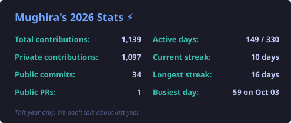

<h2 align="center">Hey, I'm Mughira 👋</h2>
<p align="center">Full-stack engineer @ Lato · Karachi · I say "it depends" professionally.</p>

```ts
const mughira = {
  builds: "React / Next.js frontends, Node / NestJS backends",
  ships_to: "AWS, Cloudflare, VPS, Vercel",
  superpower: "actually reading the error message",
};
```

<p align="center">
  
</p>

<p align="center">
  
  
</p>

<p align="center"><i>Most of my work lives in private client repos. Trust me bro. 🤝</i></p>
